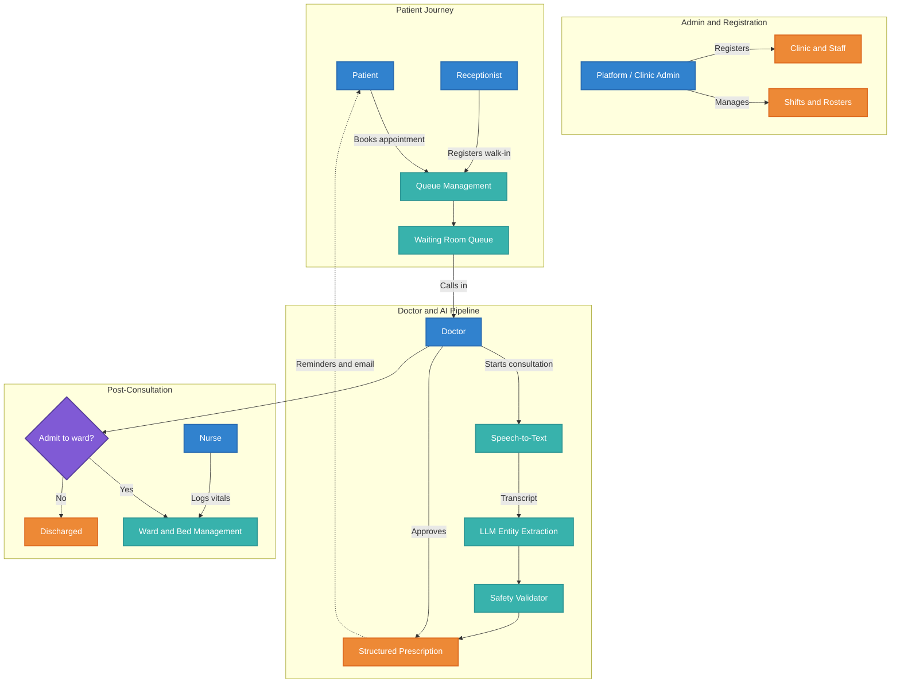

<div align="center">
  

  # MedAssist AI Suite

  **An AI-powered, multi-role clinic and hospital management platform with voice-to-prescription, multilingual speech recognition, ward management and medication reminders.**

  <p>
    
    
    
    
    
    
    
  </p>
</div>

---

## Table of Contents

1. [Overview](#overview)
2. [Key Features](#key-features)
3. [Roles and Permissions](#roles-and-permissions)
4. [System Architecture](#system-architecture)
5. [The AI Pipeline in Detail](#the-ai-pipeline-in-detail)
6. [Tech Stack](#tech-stack)
7. [Repository Structure](#repository-structure)
8. [Getting Started](#getting-started)
9. [Environment Variables](#environment-variables)
10. [Database Setup](#database-setup)
11. [Running the App](#running-the-app)
12. [Frontend Routes](#frontend-routes)
13. [API Reference](#api-reference)
14. [Deployment on Vercel](#deployment-on-vercel)
15. [Security and Privacy Notes](#security-and-privacy-notes)
16. [Troubleshooting](#troubleshooting)
17. [Roadmap](#roadmap)
18. [Contributing](#contributing)
19. [License](#license)
20. [Disclaimer](#disclaimer)

---

## Overview

**MedAssist AI Suite** is a full-stack healthcare management platform built for small clinics and multi-specialty hospitals. It connects every person in the care journey (administrators, doctors, nurses, receptionists and patients) in one system, and uses Generative AI and speech recognition to remove repetitive paperwork.

The idea at the core of the project: **a doctor should be able to speak naturally during a consultation and get a structured, validated prescription out of it.** For example:

> "Give him paracetamol 500 mg twice a day for five days and a cough syrup, 5 ml at night."

The system transcribes this, extracts each medicine with its dosage, frequency and duration, checks it for safety problems, and creates a prescription and a medicine reminder schedule for the patient.

Beyond the AI pipeline, the platform covers appointment booking, patient queue management, ward and bed management, staff shifts, analytics dashboards and email notifications.

---

## Key Features

### AI and Automation
- **Voice-to-prescription.** Record a consultation in the browser, transcribe it, and turn it into structured prescription data.
- **Multilingual speech recognition.** Supports English, Hindi, Marathi and many other languages, using Deepgram (primary), with OpenAI Whisper and Google Cloud Speech-to-Text as fallbacks.
- **LLM-based medical entity extraction.** Pulls out medicine names, dosage, frequency and duration, and tries to separate what the doctor says from what the patient says.
- **Regex NLP fallback.** If no AI key is configured, a rule-based extractor with a medicine dictionary (English, Hindi and Marathi names and brands) takes over.
- **Prescription safety validator.** Flags known drug interactions, high-alert medicines, missing fields and dosages above reference limits.
- **Patient-friendly instructions.** Generates plain-language instructions from the extracted prescription.
- **AI chat assistants** for both doctors and patients.
- **Automated medicine schedule.** Frequencies such as "twice daily" or "every 4 hours" are converted into Morning / Afternoon / Night reminder slots.

### Clinic Operations
- **Role-based dashboards** for platform admin, clinic admin, doctor, nurse, receptionist and patient.
- **Appointment booking** with clinic and doctor discovery.
- **Patient registration and live queue** managed by reception.
- **Ward and bed management.** Add beds (single or in bulk), admit patients, log vitals, release beds and discharge patients.
- **Staff management and shift scheduling.**
- **Analytics dashboards** with charts for patient flow and clinic activity.
- **Email notifications** through Brevo SMTP.
- **Password reset flow.**
- **Light and dark theme.**

---

## Roles and Permissions

Access is controlled with JWT authentication and a role check on every protected route.

| Role | What they can do |
|------|------------------|
| `platform_admin` | Register and manage clinics, view platform-wide dashboard, manage staff |
| `clinic_admin` | Manage clinic staff and shifts, view doctor and reception dashboards, create prescriptions |
| `doctor` | Run AI voice consultations, create prescriptions, manage the ward, view analytics, use the AI assistant, manage staff shifts |
| `nurse` | View admitted patients, log vitals, follow ward visit plans |
| `receptionist` | Register patients, manage the queue, handle appointments, view admitted patients |
| `patient` | Book appointments, view prescriptions, medicine schedule and reminders, health history, and use the AI health assistant |

---

## System Architecture



### Request flow

```
React + Vite (SPA)  ──►  Express REST API  ──►  Supabase (PostgreSQL)
                              │
                              ├──► Deepgram / Whisper / Google STT   (speech)
                              ├──► OpenAI-compatible LLM             (extraction, chat)
                              └──► Brevo SMTP                        (email)
```

---

## The AI Pipeline in Detail

The consultation flow runs through four stages, all orchestrated by the backend agent (`backend/ai/agent.js`).

### 1. Audio capture
The doctor opens the **Transcript Panel** in the Consultation page. The browser records audio with the native `MediaRecorder` API and uploads it to `POST /api/speech`.

### 2. Speech-to-text
`speechController.js` tries providers in this order:

1. **Deepgram** (`nova-2`, with `detect_language=true`), which handles Marathi, Hindi and mixed-language speech well.
2. **OpenAI Whisper** (`whisper-1`) with automatic language detection.
3. **Google Cloud Speech-to-Text** (optional, `en-IN`).

### 3. Entity extraction
The transcript is sent to `POST /api/agent/process`. The agent:

- Rejects empty or too-short transcripts instead of inventing a prescription.
- Calls the LLM (`ai/genai.js`) to extract structured medicines, using prompt engineering to tell doctor speech apart from patient speech.
- Falls back to the regex-based extractor (`ai/nlp.js`) if the LLM returns nothing or no key is set.

Example output:

```json
{
  "medicine": "Cough Syrup",
  "dosage": "5ml",
  "frequency": "once daily (night)",
  "duration": "5 days"
}
```

### 4. Validation and instructions
`ai/validator.js` checks the result for:

- Known dangerous interactions (for example warfarin + aspirin, SSRI + tramadol, benzodiazepine + opioid)
- High-alert drugs that always deserve a warning (insulin, digoxin, lithium and others)
- Missing dosage, frequency or duration
- Dosages above reference limits

Warnings are returned in a `warnings` array and shown to the doctor before anything is saved. The doctor reviews and approves, and the prescription is then stored and pushed to the patient, with a reminder schedule created by `reminderService.js`.

> The AI never saves a prescription on its own. A doctor always reviews and confirms.

---

## Tech Stack

**Frontend**
- React 18, TypeScript, Vite 5
- Tailwind CSS and shadcn/ui (Radix UI primitives)
- React Router v6, TanStack Query, React Hook Form with Zod
- Framer Motion for animation, Recharts for charts
- Leaflet / React Leaflet and Google Maps for clinic location
- React Markdown for rendering AI responses
- Vitest and Playwright for testing

**Backend**
- Node.js and Express
- Supabase (PostgreSQL) via `@supabase/supabase-js`
- JWT authentication with `bcryptjs` password hashing
- Multer for audio upload handling
- Nodemailer with Brevo SMTP
- `openai` SDK (works with OpenAI or any OpenAI-compatible endpoint such as NVIDIA's)

**AI and external services**
- Deepgram, OpenAI Whisper and Google Cloud Speech-to-Text for transcription
- OpenAI or NVIDIA-hosted LLMs for extraction and chat

**Deployment**
- Vercel (static frontend plus serverless Express backend)

---

## Repository Structure

```text
MedAssist-AI/
├── backend/
│   ├── ai/                 # agent.js, genai.js (LLM), nlp.js (regex fallback), validator.js
│   ├── config/             # Supabase client and seed helpers
│   ├── controllers/        # Auth, patient, prescription, ward, staff, speech, AI, dashboard...
│   ├── middleware/         # authMiddleware.js (JWT + role authorization)
│   ├── routes/             # Express route definitions
│   ├── scripts/            # SQL schemas and seed scripts
│   ├── services/           # mailer.js (Brevo), reminderService.js
│   ├── models/             # Legacy Mongoose models (not used by the Supabase backend)
│   ├── .env.example
│   ├── package.json
│   └── server.js
├── src/
│   ├── components/         # Reusable UI (AIChat, TranscriptPanel, HospitalBedManager, ui/*)
│   ├── hooks/
│   ├── lib/                # api.ts, theme context, nav config
│   ├── pages/              # Role-specific pages and dashboards
│   ├── App.tsx             # Router and role-protected routes
│   └── main.tsx
├── public/
├── .env.example            # Frontend env (VITE_API_URL)
├── vercel.json
├── vite.config.ts
├── tailwind.config.ts
└── package.json
```

---

## Getting Started

### Prerequisites

- **Node.js** 18 or newer, and **npm**
- A **Supabase** project (free tier is fine)
- An **OpenAI-compatible API key** (OpenAI, or an NVIDIA `nvapi-` key)
- A **Deepgram** API key for best multilingual transcription (optional but recommended)
- A **Brevo** account for SMTP email (optional)

### 1. Clone the repository

```bash
   git clone https://github.com/HimanshuHarinkhede/MedAssist-AI.git
   cd MedAssist-AI
```

### 2. Install dependencies

```bash
# Frontend (from the repo root)
npm install

# Backend
cd backend
npm install
cd ..
```

### 3. Configure environment variables

```bash
# Frontend
cp .env.example .env

# Backend
cp backend/.env.example backend/.env
```

Then fill in the values described in the next section.

---

## Environment Variables

### Frontend (`.env` in the repo root)

| Variable | Description | Example |
|----------|-------------|---------|
| `VITE_API_URL` | Base URL of the backend API | `http://localhost:5000/api` |

If unset, the frontend uses `http://localhost:5000/api` in development and `/api` in production.

### Backend (`backend/.env`)

| Variable | Required | Description |
|----------|----------|-------------|
| `PORT` | No | Server port (default `5000`) |
| `NODE_ENV` | No | `development` or `production` |
| `SUPABASE_URL` | **Yes** | Your Supabase project URL |
| `SUPABASE_ANON_KEY` | No | Supabase anon (public) key |
| `SUPABASE_SERVICE_ROLE_KEY` | **Yes** | Supabase service role key (server-side only, never expose it) |
| `JWT_SECRET` | **Yes** | Long random string used to sign tokens |
| `JWT_EXPIRES_IN` | No | Token lifetime, for example `7d` |
| `OPENAI_API_KEY` | For AI features | OpenAI key, or an `nvapi-` key to use NVIDIA's endpoint automatically |
| `OPENAI_MODEL` | No | Override the model (defaults to `gpt-3.5-turbo`, or `deepseek-ai/deepseek-r1` with an NVIDIA key) |
| `DEEPGRAM_API_KEY` | No | Primary speech-to-text provider |
| `GOOGLE_APPLICATION_CREDENTIALS` | No | Path to a Google service-account JSON file (optional STT fallback) |
| `FRONTEND_URL` | In production | Allowed CORS origin and link base for emails |
| `SMTP_HOST` | No | Defaults to `smtp-relay.brevo.com` |
| `SMTP_PORT` | No | Defaults to `587` |
| `SMTP_USER` | For email | Brevo SMTP login |
| `SMTP_PASS` | For email | Brevo SMTP key |
| `EMAIL_FROM` | For email | Sender, for example `"MedAssist AI" <noreply@yourdomain.com>` |
| `BREVO_API_KEY` | No | Brevo REST API fallback |

Generate a strong JWT secret with:

```bash
node -e "console.log(require('crypto').randomBytes(48).toString('hex'))"
```

---

## Database Setup

The backend uses **Supabase (PostgreSQL)**.

1. Create a project at [supabase.com](https://supabase.com).
2. Open **SQL Editor** and run the schema files from `backend/scripts/` **in this order**:
   1. `supabase_schema.sql`: clinics, users, staff, patients, appointments, prescriptions, reminders
   2. `hospital_beds_schema.sql`: ward beds
   3. `ward_admissions_schema.sql`: ward admissions
3. Copy your **Project URL** and **service role key** from *Project Settings → API* into `backend/.env`.
4. (Optional) Seed starter data:

```bash
cd backend
npm run seed
```

> Review the seed script before running it and **change any default credentials** it creates. The `seedAdmin.js`, `seedReceptionist.js` and `config/seed.js` scripts and the `models/` folder are from an earlier MongoDB version of the project and are not used by the current Supabase backend.

---

## Running the App

Open two terminals.

**Terminal 1: backend**

```bash
cd backend
npm run dev        # nodemon, http://localhost:5000
```

**Terminal 2: frontend**

```bash
npm run dev        # Vite, http://localhost:8080
```

Verify the backend is healthy:

```bash
curl http://localhost:5000/api/health
```

### Useful scripts

| Location | Command | Purpose |
|----------|---------|---------|
| root | `npm run dev` | Start the Vite dev server |
| root | `npm run build` | Production build into `dist/` |
| root | `npm run preview` | Preview the production build |
| root | `npm run lint` | Run ESLint |
| root | `npm run test` | Run Vitest unit tests |
| `backend/` | `npm run dev` | Start the API with nodemon |
| `backend/` | `npm start` | Start the API with node |
| `backend/` | `npm run seed` | Seed the Supabase database |

---

## Frontend Routes

| Area | Routes |
|------|--------|
| Public | `/`, `/login`, `/register`, `/reset-password`, `/register-clinic`, `/book-appointment` |
| Admin | `/admin/dashboard`, `/admin/staff`, `/admin/shifts`, `/admin/settings` |
| Doctor | `/doctor/dashboard`, `/doctor/patients`, `/doctor/consultation`, `/doctor/prescriptions`, `/doctor/admitted`, `/doctor/staff`, `/doctor/shifts`, `/doctor/analytics`, `/doctor/ai-assistant`, `/doctor/settings` |
| Reception | `/reception/dashboard`, `/reception/register-patient`, `/reception/patient-queue`, `/reception/admitted`, `/reception/settings` |
| Nurse / Staff | `/staff/dashboard`, `/staff/admitted`, `/staff/settings` |
| Patient | `/patient/dashboard`, `/patient/book-appointment`, `/patient/prescriptions`, `/patient/schedule`, `/patient/reminders`, `/patient/history`, `/patient/ai-assistant`, `/patient/settings` |

---

## API Reference

Base URL: `http://localhost:5000/api`. Protected routes require the header `Authorization: Bearer <token>`.

### Health
| Method | Endpoint | Description |
|--------|----------|-------------|
| GET | `/health` | Service status |

### Auth: `/auth`
| Method | Endpoint | Access | Description |
|--------|----------|--------|-------------|
| POST | `/register` | Public | Create an account |
| POST | `/login` | Public | Log in and receive a JWT |
| GET | `/me` | Authenticated | Current user |
| POST | `/reset-password` | Authenticated | Change password |

### Clinics: `/clinic`
| Method | Endpoint | Access | Description |
|--------|----------|--------|-------------|
| GET | `/public` | Public | List clinics for booking |
| POST | `/register` | platform_admin | Register a clinic |
| GET | `/` | platform_admin | List all clinics |
| GET | `/:id` | Authenticated | Get one clinic |
| PUT | `/:id` | platform_admin | Update a clinic |
| DELETE | `/:id` | platform_admin | Delete a clinic |

### Staff: `/staff`
| Method | Endpoint | Access | Description |
|--------|----------|--------|-------------|
| POST | `/add` | admin, doctor | Add a staff member |
| GET | `/list` | Authenticated | List staff |
| GET | `/:id` | Authenticated | Get a staff member |
| PUT | `/:id` | admin, doctor | Update a staff member |
| DELETE | `/:id` | admin, doctor | Remove a staff member |

### Patients and appointments: `/patient`
| Method | Endpoint | Access | Description |
|--------|----------|--------|-------------|
| POST | `/register` | Clinical staff | Register a patient |
| GET | `/my-status` | patient | Current status |
| GET | `/my-prescriptions` | patient | Own prescriptions |
| GET | `/my-schedule` | patient | Medicine schedule |
| GET | `/my-history` | patient | Health history |
| POST | `/book-appointment` | patient | Book an appointment |
| GET | `/my-appointments` | patient | Own appointments |
| GET | `/clinic-appointments` | Clinical staff | Appointments for the clinic |
| PUT | `/appointment/:id` | Clinical staff | Update an appointment |
| GET | `/queue` | Authenticated | Live patient queue |
| GET | `/list` | Authenticated | List patients |
| GET | `/:id` | Authenticated | Get a patient |
| PUT | `/:id` | Authenticated | Update a patient |

### Speech and AI
| Method | Endpoint | Description |
|--------|----------|-------------|
| POST | `/speech` | Upload audio (`multipart/form-data`, field `audio`) and get a transcript |
| POST | `/agent/process` | Run the extraction and validation pipeline on a transcript |
| POST | `/ai/chat` | Chat with the AI assistant |

### Prescriptions: `/prescription`
| Method | Endpoint | Access | Description |
|--------|----------|--------|-------------|
| POST | `/create` | doctor, clinic_admin | Create a prescription |
| GET | `/clinic/all` | Authenticated | All prescriptions for a clinic |
| GET | `/single/:id` | Authenticated | One prescription |
| GET | `/:patientId` | Authenticated | Prescriptions for a patient |

### Reminders: `/reminder`
| Method | Endpoint | Description |
|--------|----------|-------------|
| POST | `/create` | Create reminders |
| GET | `/:patientId` | Reminders for a patient |
| PUT | `/:id/taken` | Mark a dose as taken |

### Ward: `/ward`
| Method | Endpoint | Description |
|--------|----------|-------------|
| GET | `/beds` | List beds |
| GET | `/beds/stats` | Bed occupancy statistics |
| POST | `/beds/add` | Add a bed |
| POST | `/beds/bulk` | Add beds in bulk |
| DELETE | `/beds/:id` | Delete a bed |
| PUT | `/beds/:id/release` | Release a bed |
| POST | `/admit` | Admit a patient |
| GET | `/list` | List admissions |
| GET | `/patient/:patientId/history` | Admission history for a patient |
| GET | `/:id` | One admission |
| PUT | `/:id` | Update an admission |
| POST | `/:id/vitals` | Log vitals |
| PUT | `/:id/discharge` | Discharge a patient |

### Dashboards: `/dashboard`
| Method | Endpoint | Access |
|--------|----------|--------|
| GET | `/admin` | platform_admin |
| GET | `/doctor` | doctor, clinic_admin |
| GET | `/reception` | receptionist, clinic_admin |

---

## Deployment on Vercel

The repository ships with a `vercel.json` that deploys the Express backend as a serverless function and the Vite build as a static site.

1. Push the repository to GitHub.
2. Import it into [Vercel](https://vercel.com).
3. Add all backend environment variables (see the table above) in **Project Settings → Environment Variables**. Set `NODE_ENV=production` and `FRONTEND_URL` to your deployed URL.
4. Deploy. Requests to `/api/*` are routed to `backend/server.js`; everything else serves the SPA.

Because the backend is exported with `module.exports = app`, it runs as a serverless function in production and as a normal server (`app.listen`) in development.

---

## Security and Privacy Notes

This application handles medical data, so please take these seriously before using it with real patients:

- **Never commit `.env` files.** Only the `.env.example` files with placeholder values belong in Git. Rotate any key that has ever been committed.
- Keep `SUPABASE_SERVICE_ROLE_KEY` on the server only. It bypasses row-level security.
- Use a long, random `JWT_SECRET` in production.
- In development, CORS accepts any origin. In production it is restricted to `FRONTEND_URL`.
- The `/api/test-email` endpoint is for development checks only. Remove or protect it before going live.
- Audio recordings and transcripts are sent to third-party providers (Deepgram, OpenAI or others). Review their data-processing terms and your local health-data regulations before real clinical use.
- Consider enabling Supabase row-level security policies and audit logging for a production deployment.

---

## Troubleshooting

| Problem | Likely cause and fix |
|---------|----------------------|
| `Missing required environment variable` on backend start | `SUPABASE_URL`, `SUPABASE_SERVICE_ROLE_KEY` and `JWT_SECRET` must all be set in `backend/.env` |
| Frontend cannot reach the API | Check `VITE_API_URL` and that the backend is running on port 5000 |
| CORS errors in production | Set `FRONTEND_URL` to the exact deployed origin (no trailing slash) |
| Transcription returns nothing | Check `DEEPGRAM_API_KEY` or `OPENAI_API_KEY`, and allow microphone permission in the browser |
| "Transcript is too short" error | Speak for longer; transcripts under 10 characters are rejected on purpose |
| AI responses look like plain regex output | No valid `OPENAI_API_KEY` is set, so the fallback NLP is being used |
| Emails are not sent | Verify the Brevo `SMTP_USER`, `SMTP_PASS` and `EMAIL_FROM` values |
| Database errors such as missing tables | Run all three SQL schema files in the documented order |

---

## Roadmap

- [ ] Row-level security policies for Supabase
- [ ] Automated unit and integration tests for the backend
- [ ] Push and SMS medicine reminders
- [ ] Pharmacy integration and stock tracking
- [ ] Lab report upload with AI summarization for patients
- [ ] Billing and invoicing module
- [ ] Docker setup for one-command local development
- [ ] Remove the legacy MongoDB models and scripts

---

## Contributing

Contributions are welcome.

1. Fork the repository.
2. Create a feature branch: `git checkout -b feature/your-feature`
3. Commit your changes: `git commit -m "Add your feature"`
4. Push the branch: `git push origin feature/your-feature`
5. Open a Pull Request.

Please run `npm run lint` and `npm run test` before submitting.

---

## License

This project is released under the **MIT License**. Add a `LICENSE` file to the repository root with the full license text.

---

## Disclaimer

MedAssist AI Suite is an educational and demonstration project. AI-generated transcripts, extracted prescriptions and chatbot answers can contain errors. **They are not a substitute for professional medical judgment**, and every AI-assisted output must be reviewed by a qualified clinician before it is acted on. The authors accept no liability for clinical decisions made using this software.

---

<div align="center">
  Built with care for better healthcare workflows.
  Made by Himanshu 💖
</div>
